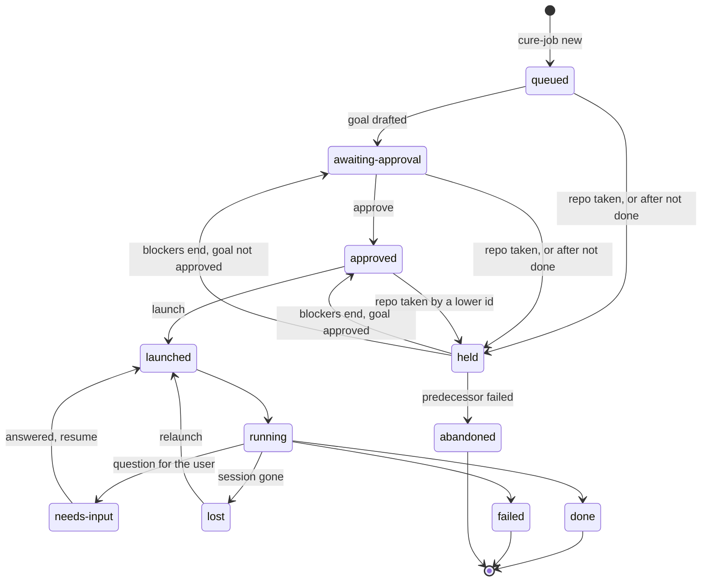
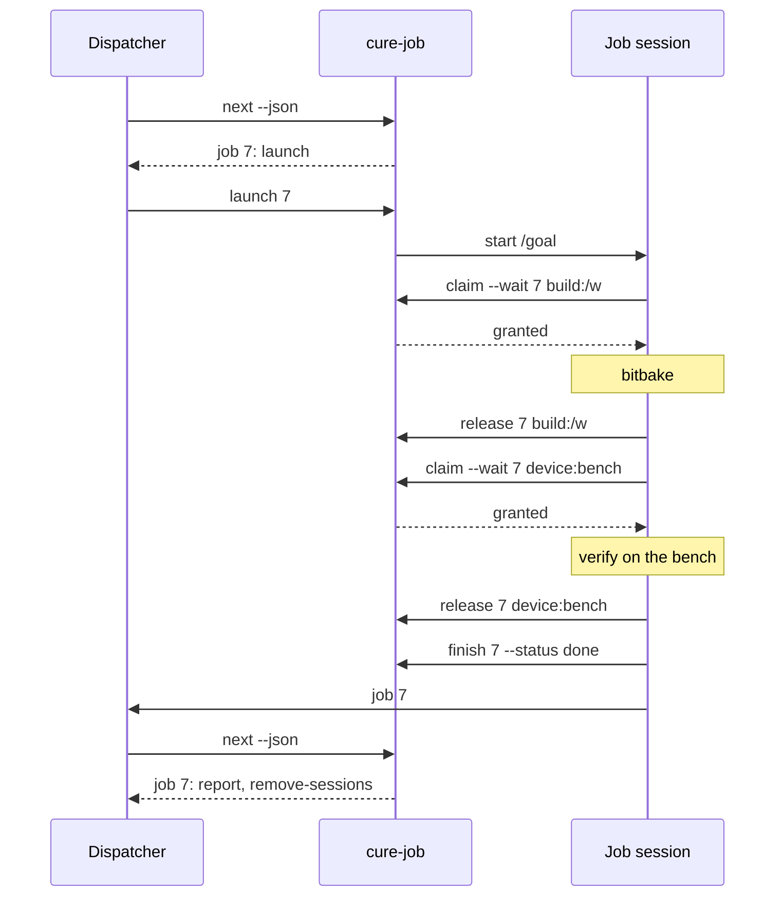
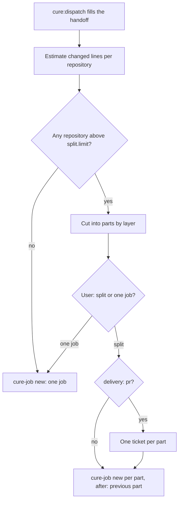

# Dispatcher resource scheduling

Status: agreed design. Each part's implementation spec is in its issue; see [Parts](#parts).

## Problem

The dispatcher queues jobs that share a resource and runs them unattended when the resource frees.
In cure 0.20.0 it does not do that well:

| Gap | Effect |
|---|---|
| A `held` job gets no goal and no approval. | The user must be present when the resource frees. |
| A job holds its resources from launch to finish. `claim` exists, `release` does not. | A job that needs the bench only for verify blocks it for hours. |
| Resources are a repository path or `device:bench` only. | Two jobs in different repos share `build/` and the bitbake lock; the CLI sees no conflict. |
| No ordering between jobs. | Stacked changes cannot be queued. |
| No size control. | A job can produce a change too large to review. |

## Decisions

| Decision | Reason |
|---|---|
| Changes stack in one workspace. No git worktrees per job. | `EXTERNALSRC` points at fixed paths under `repositories/`; a worktree would build the main checkout. |
| A job holds its repositories from launch to finish. Jobs on different repositories run at the same time. | A repository tree holds the job's uncommitted work. |
| A job holds `build:<dir>` only during a bitbake step and `device:bench` only during a verify step, through `claim --wait` and `release`. | Builds and the bench are serialised; edits and reviews of other jobs keep running. |
| The dispatcher drafts the goal and asks for approval while a job is `held`. An approved job launches when its resources free. | Unattended queueing. |
| `after: <id>` in the handoff. The job waits until the predecessor is `done` and bases its branch on it. | Stacked changes. |
| `cure-job next --json` returns the action each job needs. The dispatcher maps actions to procedures. | Conditions become tested code; the dispatcher prompt shrinks. |
| `config.json` replaces `defaults.md`. Only `config check` and `next` fail on a config error; other commands use defaults and warn. | One validated settings file. A typo never stops a running job. |
| `cure:dispatch` estimates the change. Above `split.limit` (800 lines) it proposes parts to the user as plain jobs chained with `after:`. With `delivery: pr`, each part gets its own ticket. | The working session holds the context and the user. One PR per repository per ticket. |
| `capture-idea` is removed. Its layout becomes the design note of `cure:note`. | It wrote outside the repository and duplicated `cure:note`. |

## Resources

| Resource | Held | Example |
|---|---|---|
| Repository path | Launch to `done`, `failed` or `abandoned`, through `needs-input` | `/home/u/yocto/sources/repositories/video-core` |
| `build:<dir>` | One bitbake step | `build:/home/u/yocto/build` |
| `device:bench` | One verify step | `device:bench` |

A run that holds a short hold (`build:` or `device:`) cannot wait for another resource, so no wait
cycle forms.

## Job states

An unlaunched job holds its repositories only when it is `approved`. A job that cannot launch holds
nothing.

## A run with short holds

## Split

Each part builds, passes its tests and is reviewable alone. Only the repository over the limit is
cut.

## Rejected

| Alternative | Reason |
|---|---|
| A second `repo` workspace per job. | Own `build/` per instance; disk use doubles. |
| A build-service session. | Builds come from `EXTERNALSRC` trees; the builder would need its own tree. |
| A split skill with `context: fork` run by the dispatcher. | Needs plan state files, apply and decline modes and job continuation. The dispatcher cannot ask the user mid-estimate. |
| A separate long-lived scheduler session. | Scheduling is deterministic and lives in the CLI. A second session adds a context and a message protocol. |
| Keep `defaults.md` beside a second settings file. | A markdown table has no validator, and the CLI cannot read it. |

## Parts

Each part is one job and one PR in claude-plugins, and bumps the plugin version.

| Part | Issue | Depends on | Estimate (lines) |
|---|---|---|---|
| 1 | #32 (Add cure-job release and run-scoped short holds for the bench) | none | 525 |
| 2 | #33 (Add the build:<dir> resource and the all-or-none claim) | 1 | 265 |
| 3 | #40 (Add cure-job next for the dispatcher's actions) | 2 | 430 |
| 4 | #34 (Approve a held job and launch it when its resources free) | 3 | 600 |
| 5 | #35 (Order stacked jobs with after: in the handoff) | 4 | 380 |
| 6 | #41 (Replace defaults.md with a validated config.json) | 5 | 380 |
| 7 | #36 (Split large jobs into chained jobs in cure:dispatch) | 6 | 130 |
| 8 | #37 (Remove capture-idea and add the design note to cure:note) | none | 121 |
