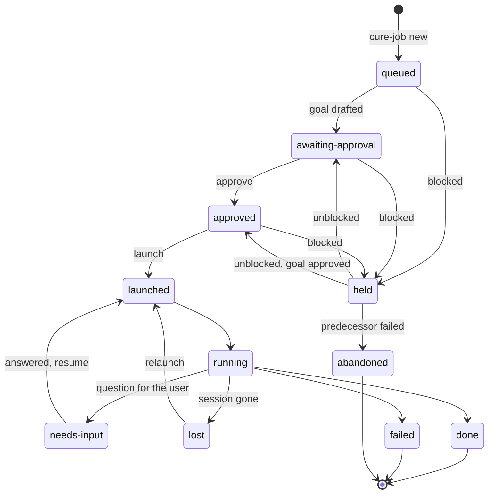
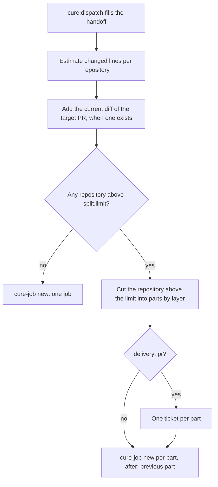

# Dispatcher resource scheduling

Status: proposed.

## Problem

The dispatcher queues jobs that share a resource and runs them unattended when the resource frees.
Cure 0.20.0 has these gaps:

| Gap | Effect |
|---|---|
| A `held` job gets no goal and no approval. | The user must be present when the resource frees. |
| Resources can be claimed but not released before the job ends. | A job that needs the bench only for verify blocks it for hours. |
| Resources are a repository path or `device:bench` only. | Two jobs in different repos share `build/` and the bitbake lock; the CLI sees no conflict. |
| No ordering between jobs. | Stacked changes cannot be queued. |
| No size control. | A job can produce a change too large to review. |

## Decisions

Each row is a rule the implementation follows, with the reason for it.

| Decision | Reason |
|---|---|
| Changes stack in one workspace. | Yocto workspace with many repos. |
| A job holds its repositories from launch to `done`, `failed` or `abandoned`. Jobs on different repositories run at the same time. | A repository tree holds the job's uncommitted work, so no other job can use it earlier. |
| A job holds `build:<dir>` only during a bitbake step and `device:bench` only during a verify step, through `claim --wait` and `release`. | Builds and the bench are serialised; edits and reviews of other jobs keep running. |
| Short holds end with the run: when the job finishes or a new run starts. A `lost` session keeps them until relaunch or close. | A forgotten `release` is bounded. The bench state after a crash is unknown. |
| Of two jobs that want the same repository, a launched job wins, then the lower id. | A fixed order: jobs run in the order they were queued. |
| The dispatcher drafts the goal and asks for approval while a job is `held`. An approved job launches when its resources free. | The user approves once; the job runs later without the user present. |
| `after: <id>` in the handoff. The job waits until the predecessor is `done` and bases its branch on it. | A stacked change needs the predecessor's commits in the tree. They exist only after `done`. |
| `cure-job next --json` returns the action each job needs. It is the only place scheduling decisions are made. The dispatcher maps actions to procedures. | Conditions become tested code; the dispatcher prompt shrinks. |
| Settings live in a validated `config.json`. A config error makes every key with an error take its default; a file that does not parse makes every key take its default. `config check` exits 1. `next` exits 0 with a `config-error` element. `prune` removes no job and exits 1. `approve --by auto` exits 1. Other commands use defaults and warn. | A typo never stops a running job. |
| `cure:dispatch` estimates the changed lines per repository from the planned work, before the job exists. The estimate includes the current diff of an existing target PR. Above `split.limit` (default 800) it splits into parts without asking the user. | The working session holds the code context and the user. |
| The goal caps the diff at twice the estimate. When the diff passes 1.5x the estimate, `cure:goal` calls `cure:split` before the push. | The estimate can be 2x low. |
| Parts are ordinary jobs chained with `after:`. | Reuses stacking; no new job type. |
| With `delivery: pr`, each part gets its own ticket. | One PR per repository per ticket. |

## Out of scope

This design does not provide:

- Two bitbake runs in one build directory at the same time.
- More than one bench device.
- Priorities other than queue order.
- Preemption of a running job.

## Resources

A job claims three kinds of resource. Each kind is held for a different span of the job.

| Resource | Held | Example value |
|---|---|---|
| Repository path | Launch to `done`, `failed` or `abandoned`, including while `needs-input` | `<yocto-root>/sources/repositories/video-core` |
| `build:<dir>` | One bitbake step | `build:<yocto-root>/build` |
| `device:bench` | One verify step | the bench camera |

### Deadlock avoidance

A job takes its repositories at launch. A run that holds a short hold never waits: it releases the
build before it claims the bench, or claims both in one call. A job waiting on a short hold
therefore holds only repositories, and no launched job waits for a repository. No wait cycle can
form.

## Job states

The CLI derives a job's state from its event log and files. The diagram shows the states and what
moves a job between them. `stalled` and `blocked`, the session states for a hung or prompting
session, are left out.



Blocked: a repository is held by a launched job or an approved job ranked before it, or the
`after:` predecessor is not `done`. An approval survives `held`. `cure-job close` abandons a job in
any state without a live session.

| State | Holds repositories |
|---|---|
| `queued`, `awaiting-approval`, `held` | no |
| `approved`, `launched`, `running`, `needs-input`, `lost` | yes |
| `done`, `failed`, `abandoned` | released |

## Short holds in one run

The diagram shows one job from launch to finish, with the messages between the dispatcher, the
`cure-job` CLI and the job session. A job claims the build and the bench only for the step that needs them; other jobs use them in
between.

```mermaid
sequenceDiagram
    participant D as Dispatcher
    participant C as cure-job
    participant J as Job session
    D->>C: next --json
    C-->>D: job 7: launch
    D->>C: launch 7
    C->>J: start /goal (Light, Full: --agent cure:orchestrator; Solo: plain session)
    J->>C: claim --wait 7 build:<yocto-root>/build
    C-->>J: granted
    Note over J: bitbake
    J->>C: release 7 build:<yocto-root>/build
    J->>C: claim --wait 7 device:bench
    C-->>J: granted
    Note over J: verify on the bench
    J->>C: release 7 device:bench
    J->>C: finish 7 --status done
    J->>D: message "job 7"
    D->>C: next --json
    C-->>D: job 7: report, remove sessions
```

## Split

`cure:dispatch` splits a change that is too large before any job exists. The diagram shows its
decisions. Each part builds, passes its tests and is reviewable alone.



## Rejected

Alternatives that were considered and not chosen, with the reason.

| Alternative | Reason |
|---|---|
| A git worktree per job. | `EXTERNALSRC` points at fixed paths under `repositories/`; a worktree would build the main checkout. |
| A second `repo` workspace per job. | Disk use doubles, and each instance needs its own `build/` and bitbake lock. |
| A build-service session. | Builds come from the `EXTERNALSRC` trees. A builder would need its own copy of them, which is the second workspace. |
| A separate long-lived scheduler session. | Scheduling is deterministic and lives in the CLI. A second session needs its own context and a message protocol. |
